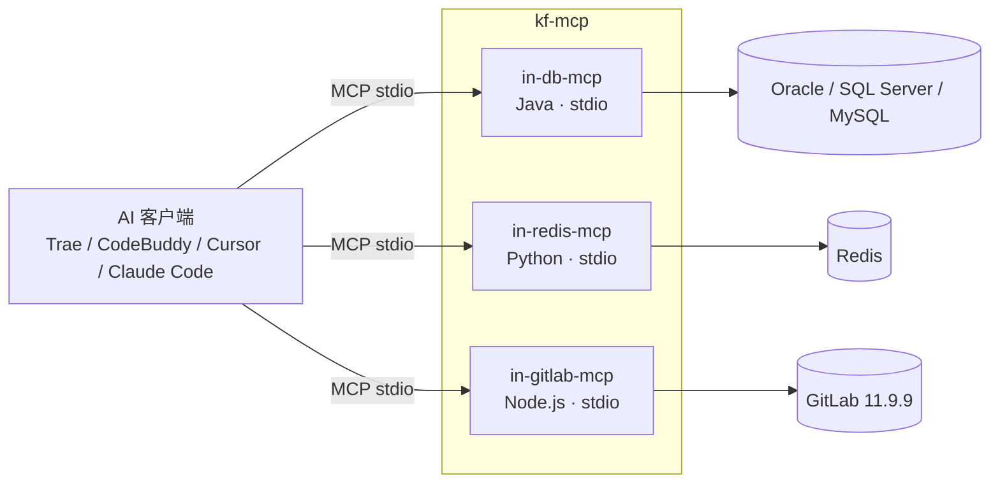

<div align="center">

# kf-mcp

**一组面向内网环境的自研 MCP Server 集合，让 AI 客户端直接读写数据库、缓存与代码平台。**

[](https://www.oracle.com/java/)
[](https://www.python.org/)
[](https://nodejs.org/)
[](https://modelcontextprotocol.io/)
[](#许可证)

</div>

## 这个集合解决什么问题

内网环境通常无法访问公网包源，也不方便给 AI 客户端装各种中间件客户端。这个集合把三类高频运维动作封装成标准 MCP Server：**查库**（无需 Oracle Instant Client）、**看缓存**、**读代码平台**。三个服务各自独立，可单独拷走使用，也可以同时注册到同一个客户端（Trae / CodeBuddy / Cursor / Claude Code 等）。

命名统一使用 `in-` 前缀：**自研** + **支持内网离线部署**。

## 三个 MCP 对比

| 名称 | 语言 | 连接对象 | 工具数 | 默认安全策略 |
|---|---|---|---|---|
| [in-db-mcp](#in-db-mcp) | Java (JDK 8+) | Oracle / SQL Server / MySQL | 10 | 只读，仅放行 `SELECT` / `WITH`，多层词法拦截 |
| [in-redis-mcp](#in-redis-mcp) | Python 3 | Redis | 10 | 读写工具均可，`flushdb` 需 `confirm="yes"` |
| [in-gitlab-mcp](#in-gitlab-mcp) | Node.js (标准库) | GitLab 11.9.9+ | 21 | 默认只读，仅下发 14 个只读工具 |

---

## in-db-mcp

**定位**：AI 数据库运维助手。单个 `dbmcp.jar` 内置 Oracle thin / mssql / mysql 驱动，免装 Instant Client 与 ODBC，覆盖"查数 + 查结构 + 查性能"。

**能力要点**

- **只读安全护栏**：仅允许 `SELECT` / `WITH` 开头；拦截多语句、注释绕过、`FOR UPDATE`、`INTO OUTFILE`、`SLEEP` / `BENCHMARK`、`UTL_*` / `DBMS_*`、`xp_cmdshell` 等危险写法，`readonly-tests.txt` 保留回归用例。
- **结构探查**：表清单、表结构（字段/类型/可空/主键/默认值/注释）、索引、按字段名反查所属表。
- **性能诊断**：TOP 慢 SQL、实时会话、执行计划、大表排行（表与索引占用空间）。
- **全操作审计**：每次工具调用落盘记录，便于事后追溯。
- **多数据源**：通过 `datasources.json` 声明，支持 `"pass": "${ENV_NAME}"` 从环境变量取密码。

**配置**（复制 `datasources.json.example` 为 `datasources.json`，该文件不入库）：

```json
{
  "datasources": [
    {
      "name": "oracle_main",
      "type": "oracle",
      "url": "jdbc:oracle:thin:@//<HOST>:1521/<SERVICE>",
      "user": "<USER>",
      "pass": "${ORACLE_PWD}"
    }
  ]
}
```

客户端注册：

```json
{
  "mcpServers": {
    "in-db": {
      "command": "java",
      "args": ["-jar", "<PATH_TO>/dbmcp.jar"]
    }
  }
}
```

---

## in-redis-mcp

**定位**：本地开发与联调时的 Redis 操作面板，免去反复敲 `redis-cli`。

**能力要点**

- 通过 **MCP stdio** 暴露 10 个工具：`ping` / `get` / `set` / `delete` / `scan` / `ttl` / `type` / `keysize` / `info` / `flushdb`。
- `scan` 基于游标遍历，不阻塞实例；`keysize` 用于排查大 key。
- `flushdb` 必须显式传 `confirm="yes"`，否则拒绝执行。
- 连接串支持 `REDIS_URL`，或分项 `REDIS_HOST` / `REDIS_PORT` / `REDIS_PASSWORD` / `REDIS_DB`。

**配置**：

```json
{
  "mcpServers": {
    "in-redis": {
      "command": "<PATH_TO>/python.exe",
      "args": ["<PATH_TO>/server.py"],
      "env": {
        "REDIS_URL": "redis://:<PASSWORD>@<HOST>:6379/0"
      }
    }
  }
}
```

依赖安装：`pip install -r requirements.txt`（`mcp>=1.0.0`、`redis>=5.0.0`）。

---

## in-gitlab-mcp

**定位**：完全离线的内网 GitLab 访问层，零 npm 依赖，一个 `server.js` 即可运行，已适配老版本 GitLab 11.9.9。

**能力要点**

- **21 个工具**：14 个只读工具默认开启，7 个写工具默认隐藏。
- 只读范围覆盖项目与成员、文件读取与项目内搜索、分支、提交、Issue、MR（含 diff）与流水线。
- 写工具（建分支、提交文件、建 Issue / MR、写评论、合并 MR）需设置 `GITLAB_READONLY=0` 才下发。
- 配置可从 `gitlab-mcp.env`（与 `server.js` 同目录自动加载）或客户端 `env` 读取。

**配置**：

```json
{
  "mcpServers": {
    "in-gitlab": {
      "command": "node",
      "args": ["<PATH_TO>/server.js"],
      "env": {
        "GITLAB_API_URL": "http://<GITLAB_HOST>/api/v4",
        "GITLAB_PERSONAL_ACCESS_TOKEN": "<TOKEN>",
        "GITLAB_TIMEOUT_MS": "30000",
        "GITLAB_READONLY": "1"
      }
    }
  }
}
```

Token 建议只授予 `read_api` scope：客户端的只读开关只是防呆，真正的边界在 GitLab 侧授权。

---

## 架构



三个 Server 之间互不依赖，均由客户端按需拉起为子进程，通过 stdin/stdout 交换 JSON-RPC 消息。

## 目录结构

```
kf-mcp/
├── in-db-mcp/
│   ├── dbmcp.jar                  # 可执行程序（内置三类数据库驱动）
│   ├── datasources.json.example   # 数据源配置模板
│   ├── mcp.json                   # 客户端配置成品示例
│   ├── readonly-tests.txt         # 只读拦截回归用例
│   ├── src/DbMcpServer.java       # 源码
│   └── README.md / SKILL.md
├── in-redis-mcp/
│   ├── server.py                  # 服务主体
│   └── requirements.txt
├── in-gitlab-mcp/
│   ├── server.js                  # 服务主体，唯一必需文件
│   ├── gitlab-mcp.env.example     # 环境变量模板
│   ├── mcp-servers.snippet.json   # 客户端配置片段
│   ├── start.cmd / start.sh       # 手动启动脚本（调试用）
│   └── README.md / SKILL.md
└── .gitignore
```

## 快速开始

1. **拷目录**：把需要的子项目整体拷到目标机器任意路径，无需联网安装主程序依赖（in-redis-mcp 需预装 Python 包）。
2. **配凭据**：数据库密码、Redis 密码、GitLab Token 统一放环境变量或客户端 `env`，不要写进仓库；数据库需先准备 `datasources.json`。
3. **注册客户端**：把对应 `mcpServers` 片段合并进客户端 MCP 配置，路径替换为绝对路径，重启客户端即可在工具列表中看到 `in-*` 工具。

## 安全说明

- 应用层校验不能替代数据库授权：连接生产库请使用只读账号，GitLab 使用最小 scope Token。
- `.gitignore` 已排除 `datasources.json`、`gitlab-mcp.env` 等含真实凭据的文件，模板 `.example` 保留入库。
- `in-db-mcp` 默认限制返回行数与执行时长，避免一次查询拖垮实例。

## 许可证

本仓库及三个子项目采用 **MIT License** 授权（仓库内未附带 `LICENSE` 文件，以此声明为准）。
